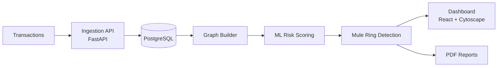

<!-- ===================================================== -->
<!--  SUMIT KHARAT — PROFILE README (v2)                    -->
<!--  Replace every YOUR_GITHUB_USERNAME before pushing.    -->
<!-- ===================================================== -->

<div align="center">


<a href="https://readme-typing-svg.demolab.com/">
  
</a>

<p>
  <a href="https://www.linkedin.com/in/sumit-kharat-b01441319"></a>
  <a href="mailto:YOUR_EMAIL"></a>
  <a href="https://YOUR_PORTFOLIO_URL"></a>
  <a href="https://YOUR_RESUME_LINK"></a>
</p>


</div>

---

## 👨‍💻 About Me

```ts
const sumit = {
  role: "Aspiring Software Developer",
  location: "India 🇮🇳",
  status: "Open to SDE / Full Stack / Backend roles (placements)",
  languages: ["TypeScript", "JavaScript", "C++", "Python", "Java"],
  currentlyBuilding: "MuleShield India — mule-account network detection (SIH, FinTech)",
  currentlyLearning: ["Graph algorithms", "System design basics", "Striver's A2Z DSA Sheet"],
  strengths: ["Problem solving", "Fast learner", "Hackathon execution"],
  askMeAbout: ["JavaScript internals", "FastAPI + ML pipelines", "DSA prep strategy"],
  funFact: "I write handwritten notes for every JS/TS topic I learn ✍️",
} as const;
```

---

## 🚀 Featured Project

<table>
<tr>
<td width="62%" valign="top">

### 🛡️ MuleShield India
**AI-powered financial mule network detection** · *Smart India Hackathon — FinTech track*

Money mules move illicit funds through chains of ordinary-looking accounts. Per-transaction rules miss them; **the network structure gives them away**. MuleShield models accounts and transfers as a graph, scores suspicious behaviour with ML, and surfaces whole mule rings to investigators.

- 🕸️ **Graph analysis** to uncover layered transfer chains and clusters
- 🤖 **ML pipeline** for account-level risk scoring
- ⚡ **FastAPI** backend with **PostgreSQL** storage
- 📄 **Automated PDF reports** for investigators
- 🖥️ React + TypeScript dashboard with Cytoscape.js network view *(in progress)*

<a href="https://github.com/YOUR_GITHUB_USERNAME/YOUR_MULESHIELD_REPO"></a>

</td>
<td width="38%" valign="top" align="center">



</td>
</tr>
</table>

---

## 🧰 Tech Arsenal

<div align="center">

| Domain | Stack |
| :-- | :-- |
| **Languages** |      |
| **Frontend** |      |
| **Backend** |     |
| **Data & ML** |      |
| **Tools** |      |

</div>

> Trim this table to what you can confidently discuss in an interview. A shorter honest stack beats a long one.

---

## 📌 Pinned Projects

<div align="center">

<a href="https://github.com/YOUR_GITHUB_USERNAME/REPO_1"></a>
<a href="https://github.com/YOUR_GITHUB_USERNAME/REPO_2"></a>

<a href="https://github.com/YOUR_GITHUB_USERNAME/REPO_3"></a>
<a href="https://github.com/YOUR_GITHUB_USERNAME/REPO_4"></a>

</div>

---

## 🧠 Currently Learning & Roadmap

<div align="center">

| Area | Focus | Progress |
| :-- | :-- | :-- |
| 🧠 **DSA** | Striver's A2Z Sheet (C++) |  |
| 🌐 **Full Stack** | React, Node, TypeScript end-to-end |  |
| 🤖 **ML / Graphs** | Fraud detection, graph analytics |  |
| 🏗️ **System Design** | Fundamentals, scaling, caching |  |
| 🔧 **DevOps** | Docker, CI/CD with GitHub Actions |  |

</div>

*(Progress bars are placeholders — edit the numbers to match reality.)*

### 🎯 2026–27 Goals
- [x] Build a hackathon-grade, end-to-end project (MuleShield)
- [ ] Finish Striver's A2Z DSA sheet
- [ ] Ship the React + Cytoscape.js dashboard for MuleShield
- [ ] Deploy 2 full stack projects with CI/CD
- [ ] Make first open-source contribution
- [ ] Land an SDE role through campus placements

---

## 📊 GitHub Analytics

<div align="center">


</div>

> 🐍 The snake needs the [Platane/snk](https://github.com/Platane/snk) GitHub Action (see setup below).

---

## 🏆 Achievements & Competitions

| | |
| :-- | :-- |
| 🇮🇳 **Smart India Hackathon** | FinTech track — MuleShield India |
| 🥇 *Add hackathon wins / ranks* | *Add details* |
| 🧩 *Add LeetCode / CodeChef rating* | *Add details* |
| 📜 *Add certifications* | *Add details* |

<div align="center">


</div>

---

## 📝 Notes & Learning in Public

I keep structured, topic-by-topic handwritten notes (simple theory + a short real-world example) for **JavaScript and TypeScript** as part of placement prep. Planning to publish them in a repo:

📘 `js-ts-placement-notes` → *(link once pushed)*

<!-- BLOG-POST-LIST:START -->
<!-- BLOG-POST-LIST:END -->

---

## 🤝 Let's Connect

<div align="center">

**Open to:** SDE / Full Stack / Backend roles · Hackathon teams · Open-source collaboration

<a href="https://www.linkedin.com/in/sumit-kharat-b01441319"></a>
<a href="mailto:YOUR_EMAIL"></a>

<br/><br/>


</div>

<!--
================ SETUP NOTES (delete before publishing) ================
1. Create a repo named exactly YOUR_GITHUB_USERNAME/YOUR_GITHUB_USERNAME; put this file in as README.md.
2. Find/replace YOUR_GITHUB_USERNAME, YOUR_EMAIL, YOUR_PORTFOLIO_URL, YOUR_RESUME_LINK,
   YOUR_LEETCODE_USERNAME, YOUR_MULESHIELD_REPO, REPO_1..REPO_4.
3. Contribution snake: add .github/workflows/snake.yml:

   name: Generate Snake
   on:
     schedule: [{ cron: "0 0 * * *" }]
     workflow_dispatch:
     push: { branches: [main] }
   jobs:
     generate:
       runs-on: ubuntu-latest
       permissions: { contents: write }
       steps:
         - uses: Platane/snk/svg-only@v3
           with:
             github_user_name: ${{ github.repository_owner }}
             outputs: dist/github-contribution-grid-snake-dark.svg?palette=github-dark
         - uses: crazy-max/github-pages-deploy-action@v4
           with:
             branch: output
             folder: dist

4. Blog list (optional): use the "blog-post-workflow" action to fill BLOG-POST-LIST.
5. The vercel-hosted stat cards occasionally rate-limit; self-host
   github-readme-stats on your own Vercel if cards show errors.
=========================================================================
-->
