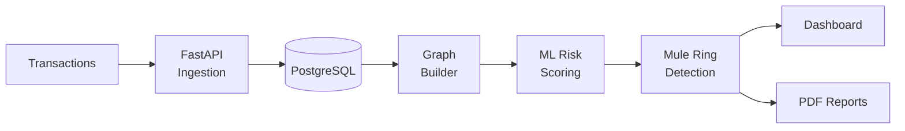

<!-- ===================================================== -->
<!--  SUMIT KHARAT — PROFILE README (v3, professional)      -->
<!--  Replace every YOUR_* / REPO_* placeholder.            -->
<!-- ===================================================== -->

 

---

## About Me

I'm a computer science student and aspiring software engineer who builds end-to-end systems: backend services, data and ML pipelines, and the interfaces that make them usable. I care about clean APIs, solid fundamentals, and shipping work that holds up under real constraints, which is what hackathons have taught me best.

I'm currently preparing for software engineering roles through campus placements, with a focus on data structures and algorithms, JavaScript/TypeScript, and full stack development.

<table>
<tr>
<td width="50%" valign="top">

**Professional Snapshot**

| | |
| :-- | :-- |
| **Focus** | Full Stack · Backend · Applied ML |
| **Core languages** | TypeScript, JavaScript, C++, Python |
| **Location** | India |
| **Status** | Open to SDE / Full Stack / Backend roles |
| **Current project** | MuleShield India |

</td>
<td width="50%" valign="top">

**Currently**

| | |
| :-- | :-- |
| **Building** | Fraud-network detection platform (Smart India Hackathon) |
| **Studying** | DSA via Striver's A2Z sheet, system design basics |
| **Strengthening** | JavaScript/TypeScript internals and CS fundamentals |
| **Next** | Deployed full stack projects with CI/CD |

</td>
</tr>
</table>

---

## Featured Project

### MuleShield India
**AI-powered financial mule network detection** · Smart India Hackathon, FinTech track

Money mules move illicit funds through chains of ordinary-looking accounts, so per-transaction rules often miss them. MuleShield models accounts and transfers as a graph, scores behaviour with machine learning, and surfaces entire mule rings for investigators.

<table>
<tr>
<td width="55%" valign="top">

| Capability | Detail |
| :-- | :-- |
| **Graph analysis** | Detects layered transfer chains and clusters |
| **ML pipeline** | Account-level risk scoring |
| **Backend** | FastAPI with PostgreSQL |
| **Reporting** | Automated PDF reports for investigators |
| **Dashboard** | React, TypeScript and Cytoscape.js network view (in progress) |

  

</td>
<td width="45%" valign="top">

</td>
</tr>
</table>

---

## Technical Skills

**Languages**

**Frontend**

**Backend and APIs**

**Databases**

**Tools and Platforms**

> Keep only what you can confidently discuss in an interview. A shorter, accurate list reads better than a long one.

---

## Selected Repositories

---

## Roadmap

| Area | Focus | Status |
| :-- | :-- | :-- |
| **Data Structures and Algorithms** | Striver's A2Z sheet in C++ | In progress |
| **Full Stack Development** | React, Node.js and TypeScript, end to end | In progress |
| **Applied ML and Graphs** | Fraud detection, graph analytics | In progress |
| **System Design** | Fundamentals, caching, scaling | Starting |
| **DevOps** | Docker, CI/CD with GitHub Actions | Starting |

**Goals**

- [x] Build an end-to-end, hackathon-grade project (MuleShield)
- [ ] Complete Striver's A2Z DSA sheet
- [ ] Ship the React and Cytoscape.js dashboard for MuleShield
- [ ] Deploy two full stack projects with CI/CD
- [ ] Make a first open-source contribution
- [ ] Secure a software engineering role through campus placements

---

## GitHub Activity

---

## Competitive Programming and Achievements

| | |
| :-- | :-- |
| **Smart India Hackathon** | FinTech track, MuleShield India |
| **Hackathon results** | Add wins, ranks or finalist status |
| **Coding profiles** | Add LeetCode / CodeChef rating |
| **Certifications** | Add relevant certifications |

---

## Learning in Public

I keep structured, topic-by-topic notes on JavaScript and TypeScript, each with a short theory summary and a real-world example. I plan to publish them as a repository: `js-ts-placement-notes` (link once pushed).

---

## Contact

Open to software engineering roles, hackathon teams and open-source collaboration.

<!--
================ SETUP NOTES (delete before publishing) ================
1. Repo must be named exactly YOUR_GITHUB_USERNAME/YOUR_GITHUB_USERNAME; save this as README.md.
2. Replace: YOUR_GITHUB_USERNAME, YOUR_EMAIL, YOUR_PORTFOLIO_URL, YOUR_RESUME_LINK,
   YOUR_LEETCODE_USERNAME, YOUR_MULESHIELD_REPO, REPO_1..REPO_4.
3. Contribution graph: add .github/workflows/snake.yml

   name: Generate Snake
   on:
     schedule: [{ cron: "0 0 * * *" }]
     workflow_dispatch:
     push: { branches: [main] }
   jobs:
     generate:
       runs-on: ubuntu-latest
       permissions: { contents: write }
       steps:
         - uses: Platane/snk/svg-only@v3
           with:
             github_user_name: ${{ github.repository_owner }}
             outputs: dist/github-contribution-grid-snake-dark.svg?palette=github-dark
         - uses: crazy-max/github-pages-deploy-action@v4
           with:
             branch: output
             folder: dist

   If you skip this, delete the snake image line.
4. Stat cards sometimes rate-limit; self-host github-readme-stats on Vercel if they error.
=========================================================================
-->
